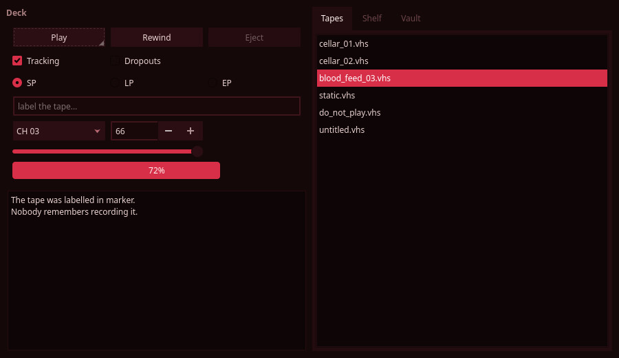
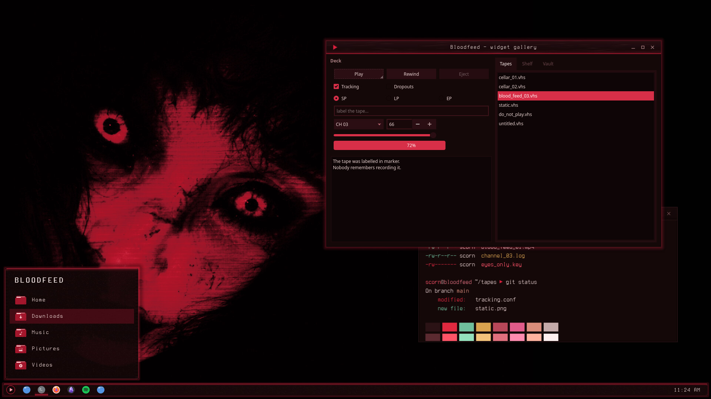

# Bloodfeed — Kvantum Theme

Kvantum widget style in blood-black with crimson accents: recessed text fields, crimson sliders, checks and progress bars, dim selections.



Bloodfeed is a blood-dubbed VHS look for KDE Plasma 6, built around a crimson-lit face on near-black: blood-black surfaces, faint scanlines and tape grain, and a slight crimson glow on whatever has focus.

## Features

- Built on KvArcDark's engine map. The greys are remapped by luminance onto a blood-black ramp, and Arc's blue becomes crimson.
- Text fields sit recessed, darker than the buttons.
- Sliders, checks, progress bars and focus rings are crimson. Selections are a dimmer crimson.
- Blurred popups. Matches the Bloodfeed colour scheme.



## Requirements

Kvantum (`kvantum` package), with the widget style set to kvantum.

## Install

```bash
git clone https://github.com/numbpill3d/bloodfeed-kvantum
cd bloodfeed-kvantum && ./install.sh
```

Or from the KDE Store: Extract to `~/.config/Kvantum/` and select **Bloodfeed** in Kvantum Manager, then set the Application Style to kvantum.

## The rest of the suite

| piece | repo |
|---|---|
| SDDM login | [bloodfeed-sddm](https://github.com/numbpill3d/bloodfeed-sddm) |
| Plymouth boot splash | [bloodfeed-plymouth](https://github.com/numbpill3d/bloodfeed-plymouth) |
| Global theme + splash screen | [bloodfeed-global](https://github.com/numbpill3d/bloodfeed-global) |
| Plasma style (panel, popups) | [bloodfeed-plasma](https://github.com/numbpill3d/bloodfeed-plasma) |
| Aurorae window decoration | [bloodfeed-aurorae](https://github.com/numbpill3d/bloodfeed-aurorae) |
| Colour scheme | [bloodfeed-colors](https://github.com/numbpill3d/bloodfeed-colors) |
| Icon theme | [bloodfeed-icons](https://github.com/numbpill3d/bloodfeed-icons) |
| Konsole + kitty colours | [bloodfeed-konsole](https://github.com/numbpill3d/bloodfeed-konsole) |

Everything at once, with the generators: [bloodfeed](https://github.com/numbpill3d/bloodfeed).

## Tags

`bloodfeed` `kde` `plasma6` `dark` `vhs` `scanlines` `crimson` `red` `blood` `horror` `retro` `analog-horror` `glow` `kvantum` `qt-style` `widget-style` `qt6` `qt5`

## Credits and licence

By splicer scorn (voidrane). GPL-3.0-or-later.
Engine map adapted from KvArcDark by Tsu Jan (Kvantum, GPL-3.0).
